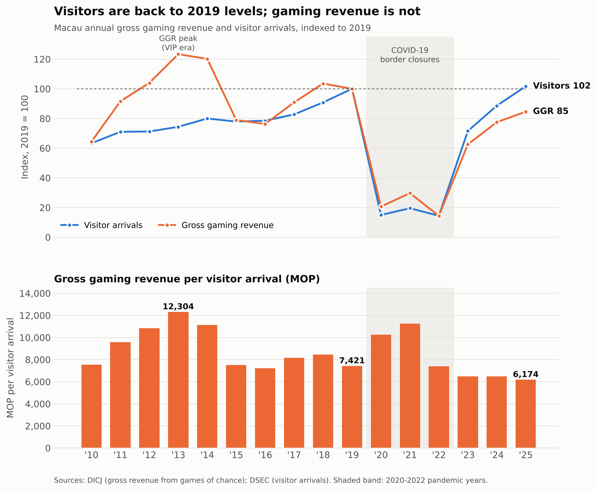

## About me

Hi, I'm **Gao Lirongyue**, a student at the University of Macau learning data science. I like questions that come from the place I live and study now, such as how Macau's casinos and tourism are changing. I care about turning data into charts that someone who is not a statistician can read in under a minute.

## Technical skills

- **Programming:** Python, Jupyter Notebook
- **Data wrangling and analysis:** pandas, NumPy
- **Visualisation:** matplotlib, seaborn 
- **Modelling:** scikit-learn (linear, polynomial and ridge regression; train/test split, cross-validation, grid search)
- **Tools:** Git and GitHub

---

## Project showcase

### Betting on Visitors: Does More Tourism Mean More Gaming Revenue in Macau?

**Status:** 🟡 Ongoing (preliminary analysis completed)

**Research question:** Does Macau's gross gaming revenue (GGR) rise and fall with the number of visitors, or has the gaming revenue each visitor brings in changed over time, especially since COVID-19?

**What the chart shows:** By 2025, visitor numbers were back above their 2019 level (102%), but gaming revenue had reached only 85% of it. So each visitor now brings in about **MOP 6,200** in gaming revenue. That is 17% less than before the pandemic and about half the 2013 peak. GGR and visitors only *look* strongly linked over 2010–2025 (r = 0.83) because both crashed together during COVID. Without the pandemic years, the correlation falls to r = 0.19.

**Limitation:** the analysis uses only 16 annual data points, so a few unusual years can swing the results. They are indicative, not conclusive.

**Data:** official statistics from DICJ (gaming revenue) and DSEC (visitor arrivals), Macao SAR Government.
**Tools:** Python, pandas, matplotlib, Jupyter.

👉 **[View the project repository (code, data and full README)](https://github.com/glry01/data-science-project)**

---

*This site is built with GitHub Pages. Source: [data-science-portfolio](https://github.com/glry01/data-science-portfolio).*
